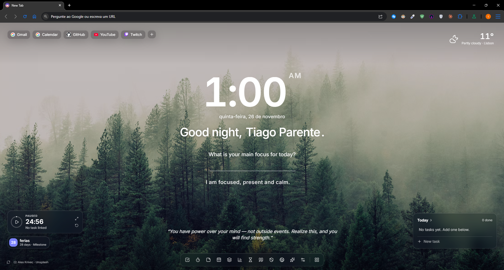

# Momento

**Make every moment count.** Momento is a calm, all-in-one productivity dashboard that replaces Chrome's new-tab page: clock, greeting and daily goal over beautiful photography, plus tasks, focus timer, notes, tab manager, calendar, stats, an AI assistant and more.

**Every feature is free.** There is no paid tier, no billing and no tracking.



---

## Features

| Area | What you get |
| --- | --- |
| Dashboard | Large clock, date, personalised greeting, daily goal, quote and mantra, weather, shortcuts, search, focus timer, countdowns, calendar preview, stats and world clocks. You can drag widgets into seven zones, hide them, or restyle them. |
| Tasks | Multiple colour-coded lists (Personal, Work, Education, Health, Projects), priorities, due dates and times, descriptions, subtasks, categories, recurring tasks, reminders, search, filter, sort and a completed view. Your most important task shows on the dashboard. |
| Focus | Full-screen Focus Mode with a Pomodoro timer (25/5/15 by default, all configurable). You can link a session to a task. Includes synthesized ambient sounds, notifications at the end of a session, and daily and weekly stats. |
| Site blocker | Blocklist with an allowlist. Blocking can be always on, on during focus sessions, or on a schedule (days and time ranges), and you can snooze it. Built on `declarativeNetRequest`. |
| Notes | Rich text, folders, pinning, search, timestamps and autosave. |
| Tabs | Tab Stash saves all open tabs or the current window and restores them later. Tab Groups are named, coloured collections you can open in one click. |
| Calendar | Month, week and day views, an agenda, events with reminders, and read-only Google Calendar and Outlook overlays. |
| Stats | Focus time, sessions and tasks completed per day, week and month, completion rates, goals, and custom metrics (books, workouts, water, etc.). |
| Inspiration | Daily quote and mantra, your own quotes and mantras, favourites, history, and random quotes. |
| Customisation | Rotating Unsplash photos by category, your own uploads, gradients and solid colours. Also light, dark or system theme, an accent colour (manual or matched to the photo), 10 fonts, dimming and the glass effect. |
| Weather | Open-Meteo data (no key needed): current conditions, hourly and 5-day forecasts, sunrise and sunset, and air quality. Uses your location or a city you search for. |
| World clocks | City search, multiple time zones, automatic DST, reordering. |
| Momento AI | Plan my day, break a goal into tasks, task lists, brainstorming, note summaries, study plans, productivity tips, motivation and daily reflection. Suggested tasks can be added with one click. |
| Balance Mode | Working hours schedule. Outside those hours, chosen widgets are hidden, and you get break reminders and an end-of-day nudge. |
| Integrations | Google Calendar, Outlook, Google Tasks, Todoist, Trello, Asana, ClickUp and GitHub, all through their official APIs. Basecamp, Spotify and YouTube are listed but marked "not yet supported" (see below). |
| Accounts & sync | Optional. Supabase email/password auth, password reset, profile and cloud sync across devices. Row-level security means each user can read only their own row. |
| Data | JSON export and import, a full reset, and account deletion. |

## Install (load unpacked)

```bash
npm install
npm run build        # type-checks, then builds into dist/
```

1. Open `chrome://extensions` and turn on **Developer mode**.
2. Click **Load unpacked** and select the `dist/` folder.
3. Open a new tab.

For UI development you can run `npm run dev` and open `http://localhost:5173/newtab.html`. Pages fall back to `localStorage` there. Extension-only APIs (tabs, blocking, notifications, OAuth) are disabled in that mode.

Keyboard shortcuts on the dashboard: `T` tasks, `F` focus, `N` notes, `C` calendar, `S` settings, `A` AI, `Esc` closes the current panel. `Alt+M` opens the popup.

## Optional setup

Everything works locally without any setup. The steps below are only for the extra cloud features.

### Cloud sync & accounts (Supabase)

1. Create a Supabase project.
2. Run `supabase/migrations/0001_init.sql`, either in the SQL editor or with `supabase db push`. It creates the `momento_state` table and its RLS policies.
3. Deploy account deletion: `supabase functions deploy delete-account`.
4. Enter your project URL and **anon** key in **Settings → Account & profile**. Momento doesn't ship with a Supabase project, so each user connects their own.

Never put the service-role key in the extension. Sync is last-write-wins. Integration tokens, AI keys and caches are never synced.

### Momento AI

Momento AI uses your own Anthropic API key. Paste it in **Settings → Momento AI**. Momento doesn't ship a key or run a proxy server. The key is stored only in this browser's extension storage and is sent straight to api.anthropic.com. The settings page explains this trade-off.

The default model is Claude Opus 5.5. You can switch to Sonnet 5.5 or Haiku 5.5. Replies are streamed. If no key is set, the panel says so instead of returning fake answers.

### Integrations

- **Google Calendar / Google Tasks.** Create a Google OAuth client of type *Web application* and enable the Calendar API and Tasks API. Add the redirect URI shown in **Settings → Integrations** (`https://<extension-id>.chromiumapp.org/`), then paste the client ID.
- **Outlook.** Create an Entra app registration with the SPA platform and that same redirect URI. Enable access tokens, add the `Calendars.Read` permission, then paste the application (client) ID.
- **Todoist, GitHub, Asana, ClickUp.** Paste a personal access token.
- **Trello.** Paste an API key and a token.
- **Basecamp, Spotify, YouTube.** Not implemented. They need registered developer apps and server-side token exchange or app verification. The UI says this plainly rather than faking a connection.

Google and Microsoft tokens come from the token flow and expire after about an hour. When that happens, the card shows **Reconnect**.

## Permissions

| Permission | Why |
| --- | --- |
| `chrome_url_overrides.newtab` | The dashboard |
| `storage`, `unlimitedStorage` | Local-first data, including custom photos |
| `alarms`, `notifications` | Focus timer, reminders, break nudges |
| `tabs`, `tabGroups` | Tab Stash and Tab Groups |
| `declarativeNetRequest` + `<all_urls>` | Site blocker (redirect to the "Stay focused" page) and API calls to integrations |
| `identity` | OAuth sign-in for Google and Microsoft |
| `search` | The search widget uses your default search engine |
| `geolocation` | Optional "use my location" for weather |

## Browser limitations

- The site blocker is limited by `declarativeNetRequest`. Chrome caps the number of dynamic rules, it can't block `chrome://` pages or other extensions, and incognito works only if you allow the extension there.
- Ambient sounds play only while Focus Mode is open. The timer, notifications and blocking keep running in the background service worker.
- Chrome alarms fire with roughly 30-second granularity, so notifications can arrive a few seconds late.
- Chrome extensions cannot write directly to Google or Outlook calendars from a pure client without a backend, so calendar integrations are read-only.

## Porting to other browsers

- **Edge, Brave, Opera, Arc:** load the same `dist/` folder. These browsers are Chromium-based and use MV3.
- **Firefox:** MV3 is supported, but you need to change a few things:
  - use `background.scripts` instead of `service_worker`
  - add `browser_specific_settings.gecko.id`
  - `chrome.identity.getRedirectURL()` returns an `*.extensions.allizom.org` URL, which must be registered with your OAuth apps
  - Firefox does not support `tabGroups`, so any calls to that API must be guarded; saved collections work without it
- Browser APIs are accessed only through `src/lib/storage.ts`, the background modules and a few feature modules, so a `webextension-polyfill` shim can be added in one place.

## Project structure

```
src/
  background/      MV3 service worker modules (focus, blocker, reminders, balance)
  components/      UI kit + PanelFrame
  lib/             storage, persistence, appearance, sync, ai, integrations/
  stores/          persisted zustand stores (one chrome.storage key each)
  newtab/          dashboard, widgets/, panels/
  popup/           toolbar popup
  blocked/         "Stay focused" page shown for blocked sites
supabase/          SQL migration + Edge Function (delete-account)
```
